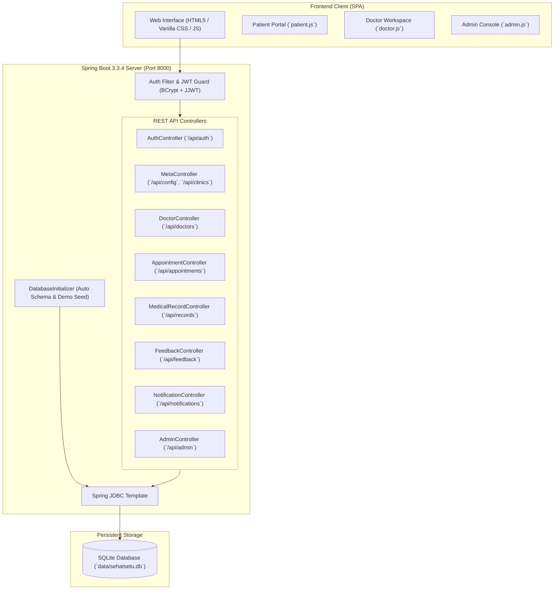

# 🏥 SehatSetu — Healthcare Management Platform

[](https://www.oracle.com/java/)
[](https://spring.io/projects/spring-boot)
[](https://www.sqlite.org/)
[](https://jwt.io/)
[](./openapi.json)

> **"Better Care. Simpler Healthcare."**  
> **SehatSetu** is an end-to-end, production-ready healthcare management platform designed for the Indian healthcare ecosystem. It streamlines doctor-patient consultations, appointment scheduling, digital health records, and administrative analytics within a responsive, secure, unified portal.

---

## 🌟 Highlights & Key Features

### 👤 Patient Portal
* **Doctor Discovery & Filtering**: Search certified doctors by medical speciality (Cardiology, Dermatology, Pediatrics, Orthopedics, Neurology, etc.) and clinic locations across Delhi, Noida, Bengaluru, and more.
* **Smart Appointment Booking**: Seamlessly book in-clinic visits or virtual video consultations with real-time slot availability.
* **Digital Health Vault**: View complete medical history, doctor diagnoses, and digital prescriptions.
* **Patient Reviews & Ratings**: Submit verified doctor feedback with 1–5 star ratings and reviews.
* **Instant Notifications**: Automated updates for appointment confirmations, reschedules, and prescription readiness.

### 🩺 Doctor Workspace
* **Practice Dashboard**: Real-time view of daily appointments, patient queues, and consultation statuses (`SCHEDULED`, `COMPLETED`, `CANCELLED`).
* **Clinical Records Management**: Record patient symptoms, diagnoses, vital stats, and prescribed medications during consultations.
* **Patient Longitudinal History**: Access past consultation records and medical history before and during visits.
* **Reputation & Feedback**: Track patient satisfaction ratings and reviews.

### 🛡️ Hospital & System Administration
* **Executive Analytics**: Live overview of total consultations, patient registrations, active doctors, and platform revenue in Indian Rupees (₹).
* **Clinic & Practitioner Management**: Onboard, verify, and manage healthcare providers and multi-city clinic branches.
* **Audit & System Configuration**: Granular Role-Based Access Control (RBAC) and platform configuration.

---

## 🏗️ Architecture



---

## 🧰 Technology Stack

| Layer | Technologies |
| :--- | :--- |
| **Backend Framework** | Java 17, Spring Boot 3.3.4 (`spring-boot-starter-web`, `spring-boot-starter-jdbc`) |
| **Authentication & Security** | JWT (JJWT `0.12.5`), Password Hashing (jBCrypt `0.4`), Role-Based Access Control (RBAC) |
| **Database** | SQLite 3 via `sqlite-jdbc` with automated schema bootstrapping & WAL mode |
| **Frontend** | Modern Vanilla JavaScript (ES6+), Vanilla CSS (Glassmorphism & Responsive Design), Semantic HTML5 |
| **API Specification** | OpenAPI 3.0.3 (`openapi.json`) |
| **Testing & QA** | Spring Boot Test / JUnit 5, Python Automated Integration Suite (`test_sehatsetu.py` via `httpx`) |

---

## 🚀 Quick Start Guide

### Prerequisites
* **Java Development Kit (JDK) 17** or higher
* **Python 3.9+** *(optional, for one-click launcher and integration tests)*
* **Git**

### 1. Clone the Repository
```bash
git clone https://github.com/Ayushveersingh-create/healthcare-management.git
cd healthcare-management
```

### 2. Run the Application

You can launch the full application in either of two ways:

#### Option A: One-Click Python Launcher (Recommended)
```bash
python run.py
```

#### Option B: Direct Maven Wrapper
**On Windows:**
```powershell
cd java-backend
.\mvnw.cmd spring-boot:run
```

**On Linux / macOS:**
```bash
cd java-backend
./mvnw spring-boot:run
```

Once started, open your web browser and navigate to:
👉 **[http://127.0.0.1:8000](http://127.0.0.1:8000)**

---

## 🔑 Pre-Seeded Demo Credentials

The database initializes automatically on first run with demo accounts for each role:

| Role | Email / Username | Password | Access Capabilities |
| :--- | :--- | :--- | :--- |
| **Patient** | `aarav.singh@gmail.com` | `Patient@123` | Book doctors, view records, leave feedback |
| **Doctor** | `ananya.sharma@sehatsetu.in` | `Doctor@123` | Patient queue, prescribe drugs, diagnosis |
| **Admin** | `admin@sehatsetu.in` | `Admin@123` | Analytics, clinic metrics, user management |

> 💡 *A **Quick Demo Login** panel is also built directly into the login modal for instant 1-click access during evaluations.*

---

## 📡 API Reference Overview

The platform exposes a full RESTful API under `/api/*`. Refer to [`openapi.json`](./openapi.json) for the interactive OpenAPI 3.0 schema.

### Core Endpoints

| Method | Endpoint | Description | Auth Required |
| :--- | :--- | :--- | :---: |
| `GET` | `/api/config` | Platform metadata, currency (`₹`), and IST timezone | No |
| `GET` | `/api/specialities` | Available medical specialities | No |
| `GET` | `/api/clinics` | Registered clinic locations and contact info | No |
| `POST` | `/api/auth/login` | Authenticate user & issue JWT bearer token | No |
| `POST` | `/api/auth/demo-login` | Quick login for testing roles | No |
| `GET` | `/api/doctors` | Query active doctors with speciality & city filters | No |
| `POST` | `/api/appointments` | Schedule a new appointment | Yes (Patient) |
| `GET` | `/api/appointments/my` | Retrieve patient or doctor appointment list | Yes |
| `PUT` | `/api/appointments/{id}/status` | Update consultation status (`COMPLETED`, etc.) | Yes (Doctor) |
| `POST` | `/api/records` | Create electronic medical record / prescription | Yes (Doctor) |
| `GET` | `/api/records/my` | View authenticated patient medical records | Yes (Patient) |
| `POST` | `/api/feedback` | Post doctor rating and review | Yes (Patient) |
| `GET` | `/api/admin/stats` | Retrieve platform-wide KPIs and revenue figures | Yes (Admin) |

---

## 🧪 Testing & Quality Assurance

### Run Spring Boot Unit & Integration Tests (JUnit 5)
```bash
cd java-backend
.\mvnw.cmd test
```

### Run Automated End-to-End API Test Suite (Python)
Ensure the server is running on `http://127.0.0.1:8000`, then execute:
```bash
python test_sehatsetu.py
```
This suite verifies:
* Public configuration and clinic discovery
* Role-based demo logins & password enforcement
* Doctor discovery and appointment slot booking
* E-prescription and medical record persistence
* Patient feedback submission and rating aggregations
* Administrative analytics endpoint permissions

---

## 📂 Project Structure

```text
healthcare-management/
├── frontend/                       # Web frontend assets (SPA)
│   ├── css/
│   │   └── custom.css             # Glassmorphic, modern responsive styles
│   ├── js/
│   │   ├── app.js                 # App routing, modals, auth flow
│   │   ├── patient.js             # Patient booking & record interactions
│   │   ├── doctor.js              # Doctor consult & clinical notes
│   │   └── admin.js               # Admin analytics & metrics
│   └── index.html                 # Main Single Page Application entry
├── java-backend/                  # Spring Boot 3 backend service
│   ├── src/main/java/com/sehatsetu/
│   │   ├── config/                # DatabaseInitializer, WebConfig & CORS
│   │   ├── controller/            # REST API endpoints (Auth, Doctors, Appointments, etc.)
│   │   └── util/                  # JwtUtil, PasswordUtil (BCrypt)
│   ├── src/main/resources/
│   │   └── application.properties # Server port (8000), DB connection, static mapping
│   ├── src/test/java/             # Comprehensive JUnit 5 test suite
│   ├── mvnw / mvnw.cmd            # Maven Wrappers
│   └── pom.xml                    # Project dependencies
├── data/                          # SQLite database store (auto-created)
├── openapi.json                   # OpenAPI 3.0 API Specification
├── run.py                         # One-click application launcher
├── test_sehatsetu.py              # Automated integration test suite
└── README.md                      # Project documentation
```

---

## 📜 License

This project is licensed under the [MIT License](LICENSE).

---

## 👨‍💻 Author

Developed by **Ayushveer Singh** ([@Ayushveersingh-create](https://github.com/Ayushveersingh-create)).
